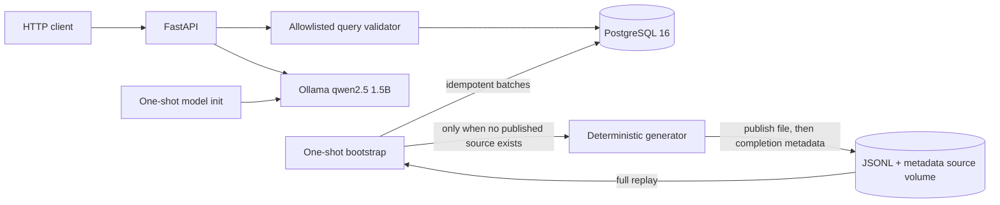

# AI-Queryable Health Data System

A small end-to-end system that generates a fixed, deterministic synthetic
heart-rate snapshot for 50 users over 21 days, atomically publishes it as
JSONL, replays that persisted source into PostgreSQL, and exposes bounded
structured and natural-language analytics.
It is a reproducible fixed synthetic demo, not a continuously updating or real-time
health service.

The generated patterns are for an engineering demonstration. They are not
clinically validated measurements and must not be used for health decisions.

## Quick start

Prerequisites:

- Docker Engine with Docker Compose v2
- Approximately 6 GB of free disk space
- Internet access on the first start for container images, Python packages,
  and the local model
- An ARM64 or AMD64 machine supported by the pinned images

Start the complete system:

```bash
docker compose up --build
```

No model command, schema command, or data-loading command is required.
Compose starts PostgreSQL and Ollama, downloads `qwen2.5:1.5b` through a
one-shot model preparation service, publishes and ingests the fixed dataset,
then starts FastAPI. The default base URL is <http://127.0.0.1:8000>.

The first start is download-heavy. Wait for `api` to report healthy:

```bash
docker compose ps --all
curl --fail http://127.0.0.1:8000/health/ready
```

Stop services while preserving data:

```bash
docker compose down
```

Remove all persisted demo data and the downloaded model:

```bash
docker compose down --volumes
```

## HTTP endpoints

The application exposes:

- `GET /` — return a 307 redirect to `/docs`.
- `GET /docs` — open the interactive Swagger UI.
- `GET /docs/oauth2-redirect` — handle the Swagger UI OAuth2 callback; this
  route is generated automatically even though this demo does not implement
  authentication.
- `GET /redoc` — open the alternative ReDoc API documentation.
- `GET /openapi.json` — return the OpenAPI schema.
- `GET /health/live` — report application-process liveness.
- `GET /health/ready` — check database connectivity, completed ingestion,
  observations present, and model availability. It lists the model but does
  not run inference.
- `POST /v1/query` — execute bounded structured analytics; see the
  [structured query examples](#analytical-api).
- `POST /v1/query/natural-language` — translate supported English questions
  into validated query plans; see the
  [natural-language example](#constrained-natural-language-layer).

The automatically generated documentation and schema routes also accept
`HEAD`.

## Architecture



Compose contains five purposeful services:

- `postgres` stores user profiles, observations, constraints, indexes, and the
  identity and outcome of the one accepted source.
- `bootstrap` atomically publishes the fixed event sequence to the source
  volume when absent, then replays it in retry-safe batches. It exits only
  after all source records have been checked against durable rows.
- `ollama` hosts the small local interpretation model.
- `model-init` downloads the pinned model when the model volume is empty and
  exits after preparation succeeds.
- `api` starts only after bootstrap and model preparation finish. It serves
  health, structured analytics, natural-language analytics, and OpenAPI.

For this bounded 21-day input, publishing a file and replaying transactional
batches keeps ingestion and recovery simple. Continuous arrivals would be a
different requirement; a broker would need a concrete benefit to justify its
operational cost.
PostgreSQL is both storage and analytical engine because this volume and the
bounded access patterns fit indexed relational aggregation.

## Data contract and synthetic patterns

The full contract and acceptance criteria are in
[`docs/specification.md`](docs/specification.md). Each v1 observation contains:

- schema version `health.heart_rate.observation.v1`;
- stable UUIDv5 event ID;
- stable user and device IDs;
- an offset-aware observation timestamp;
- metric `heart_rate`, a decimal value, and unit `bpm`;
- one of `sleep`, `rest`, `ordinary_activity`, or `workout`.

The fixed default configuration is seed `20261019`, 50 users, and
`2026-10-05T00:00:00Z` through `2026-10-26T00:00:00Z`, using a half-open
interval that includes 5–25 October. Profiles vary by time
zone, resting baseline, schedule, activity response, workout frequency, and
device-off tendency. State changes affect values and sampling cadence;
deterministic jitter avoids clockwork intervals; device-off intervals emit no
observations.

Determinism makes the synthetic fixture reproducible for review and tests. It
does not imply that missing measurements from real people can be regenerated.
Every value is synthetic, including dates that are in the future when the
demonstration is prepared; they are not measurements already collected.

The 50 synthetic users produce 814,492 observations in the default 21-day
sample; users and observations are different counts. Representative profiles,
state-level means, a full local-day timeline, and an explicit 83.9-minute
no-reading gap are in
[`docs/synthetic-sample.md`](docs/synthetic-sample.md).

## Idempotent ingestion and recovery from persisted source

This is the first area of deliberate depth.

Bootstrap writes one event per JSONL line to a temporary file on the source
volume, flushes it, and publishes it with an atomic rename only after generation
finishes. A small sidecar records the generation configuration, line count,
unique-event count, and source digest. A compatible published source is
validated and reused without calling the event generator. An incompatible or
corrupt published source fails explicitly; a lone file from an interrupted
initial publication is not considered complete and may be regenerated.

Idempotent means that retrying the same event leaves the database with the
same observation, rather than adding another copy. A new measurement is a new
event, not a retry. This is not a general end-to-end exactly-once guarantee.
Every ingestion attempt reads that JSONL from the beginning. There is no
position checkpoint: the measured full replay is small enough that stable
event identity and idempotent inserts are simpler. Each batch commits
independently, so an interruption can leave earlier batches durable. On retry,
those rows are verified and skipped while missing rows are inserted:

- the same `event_id` and same content is accepted without another row;
- the same `event_id` with different content is an explicit error;
- a natural-key collision under another ID is an explicit error;
- malformed JSONL reports its line number instead of being ignored;
- file order is irrelevant because analytics use `observed_at`.

The demo database accepts one source configuration. Another seed, window,
population, generator version, or source content requires an isolated
database; dataset migration and coexistence are outside scope.

The recovery harness interrupts ingestion after observing committed progress,
then replays the same retained file from line one and compares the final rows
with an uninterrupted load:

```bash
./scripts/test_interrupted_ingestion.sh
```

The recorded run demonstrates recovery with earlier batches already committed.
Polling does not establish whether another transaction was open at the signal
instant. Counts, digests, and timings remain in
[`docs/october-2026-verification.md`](docs/october-2026-verification.md#replay-restart-and-interruption).

The named volume survives normal container replacement; it is not a backup,
replica, or protection against deleting or losing the volume. Real
measurements that were never persisted cannot be reconstructed by a
deterministic generator.

## Analytical API

This is the second area of deliberate depth: explicit semantics when sampling
is irregular and data can be absent.

Every range is half-open: `start <= observed_at < end`. Timestamps require an
offset and ranges are limited to 31 days. This is a request guardrail, not
the dataset horizon: the 21-day sample is never filled with invented
readings when a query spans more dates. Responses allow row_limit from 1 to
1,000 (default 1,000).
An empty match returns HTTP 200 with an empty `rows` array. Oversized results
return HTTP 413 rather than silent truncation. Unsupported operations, metrics,
dimensions, users, and malformed timestamps return structured errors. Error
responses should explain the failure without leaking database credentials or
internal implementation details.

Five operations exist. Every reported `time_weighted_mean_bpm` uses a
bounded constant-hold approximation. A reading represents its value from its
timestamp until the earliest of the next reading for the same
user/device/metric, `MAX_HOLD_SECONDS`, or the request end. The default and
Compose setting is `HEALTH_DATA_MAX_HOLD_SECONDS=360`. This is an explicit
engineering assumption about how long a reading remains usable, not a clinical
rule. There is no linear interpolation, unlimited extrapolation, or zero fill.
Responses identify this as
`aggregation_basis: "time_weighted_observation_hold"` and expose the applied
`max_hold_seconds`.

The next reading is found before any activity-state filter is applied, so a
rest interval stops when a later workout reading arrives. The immediately
preceding reading can carry into the request only for the validity it still has
left from its original timestamp. Intervals are clipped to `[start,end)` and
split at local-day or UTC-day boundaries using real instants, including
daylight-saving transitions.

- `user_period_average`: one time-weighted mean of all valid intervals for one
  user over the whole request;
- `user_period_resting_average`: one mean of intervals originating from that
  user's `rest` readings;
- `daily_user_average`: the same rest-only calculation grouped by the user's
  local day;
- `activity_state_comparison`: intervals grouped by the state of their
  originating reading;
- `population_daily_average`: a UTC-day mean pooled over valid user-seconds,
  not an average of per-user means.

The limit counts aggregated output rows, not raw measurements. For example, four activity-state groups with row_limit=2 return HTTP 413, with no partial result. The default and maximum row_limit is 1,000; the current four-state or daily operations over at most 31 days cannot normally reach that ceiling.

Each result row includes the duration that actually contributed:
`contributing_duration_seconds` for individual operations or
`contributing_user_seconds` plus `contributing_user_count` for population
days. A separate top-level `quality` object remains present even when `rows`
is empty. Individual quality reports requested, observed and unobserved
seconds, gap count and largest gap using availability of any heart-rate
reading before a rest filter. Workout time excluded from a resting mean is
therefore not mislabeled as missing device data.

Population quality calculates gaps independently per expected user from the
`users` table. It reports requested, observed and unobserved user-seconds,
expected and observed user counts, total gap count, and the largest individual
gap. One person's reading never covers another person's time. These are
availability indicators under the maximum-hold rule, not physiological
coverage. Missing groups stay absent: the API never invents a zero mean, and a
fully missing request still returns quality metadata with `rows: []`.

SQL operation and grouping fragments are application-owned constants. Every
request value is a bound parameter. No route accepts arbitrary SQL.

Whole-period average (all states):

```bash
curl --fail --request POST http://127.0.0.1:8000/v1/query \
  --header 'Content-Type: application/json' \
  --data '{"operation":"user_period_average","user_id":"user-0001","start":"2026-10-05T00:00:00Z","end":"2026-10-26T00:00:00Z"}'
```

Use `user_period_resting_average` for a rest-only period mean. Both return
zero or one row with `time_weighted_mean_bpm` and
`contributing_duration_seconds`; `start` and `end` describe the requested
interval. The mean is calculated directly from held value-seconds, not from
daily means. No schema migration is needed.

Natural-language examples: “What was user-0001's average heart rate last week?”
and “What was user-0001's average resting heart rate last week?” select the
all-state and rest-only period operations respectively. Add “each day” to the
resting question to request `daily_user_average`, whose semantics are unchanged.
Unsupported hourly/device grouping, maximum, and median remain rejected.

Daily resting average:

```bash
curl --fail --request POST http://127.0.0.1:8000/v1/query \
  --header 'Content-Type: application/json' \
  --data '{
    "operation": "daily_user_average",
    "user_id": "user-0001",
    "metric": "heart_rate",
    "start": "2026-10-05T00:00:00Z",
    "end": "2026-10-26T00:00:00Z"
  }'
```

Activity-state comparison:

```bash
curl --fail --request POST http://127.0.0.1:8000/v1/query \
  --header 'Content-Type: application/json' \
  --data '{
    "operation": "activity_state_comparison",
    "user_id": "user-0001",
    "metric": "heart_rate",
    "start": "2026-10-05T00:00:00Z",
    "end": "2026-10-26T00:00:00Z"
  }'
```

Population daily average:

```bash
curl --fail --request POST http://127.0.0.1:8000/v1/query \
  --header 'Content-Type: application/json' \
  --data '{
    "operation": "population_daily_average",
    "metric": "heart_rate",
    "start": "2026-10-05T00:00:00Z",
    "end": "2026-10-26T00:00:00Z"
  }'
```

## Constrained natural-language layer

This is Bonus 2, implemented as a constrained interface over the same validated
structured-query path rather than a third claimed depth area.

The small local model avoids paid API keys and keeps inference local. Its
JSON output is validated before the query engine is called.
Ollama receives a question and returns only a candidate JSON plan for the five
operations. The application then:

1. accepts either two offset-aware RFC 3339 timestamps, including fractional
   seconds, or the explicit phrase `last week`;
2. resolves `last week` at request time to the previous ISO week in application
   time zone `UTC`;
3. rejects missing user identity, unsupported metrics, unsupported
   aggregations, medical-advice requests, unsupported relative dates, and
   instruction-like input;
4. validates the model response with a strict, extra-field-forbidden schema;
5. checks exact user tokens and recognized timestamp, aggregation, grouping,
   state-filter, time-zone, and operation cues against a bounded lexical
   contract;
6. applies the same structured-query validation and limits;
7. builds parameterised SQL from application-owned statements.

Model output is never treated as SQL and SQL fields are rejected. Missing or
ambiguous scope is rejected instead of inferred. Model unavailability returns
HTTP 503. Every successful response includes `interpreted_query` and
`temporal_interpretation`, including the resolved range, reference time, and
time zone, beside the result. First-person questions such as “my heart rate”
without an explicit user ID are rejected because authentication is not
implemented and there is no authenticated identity to resolve.
This validator deliberately recognizes a constrained vocabulary; it rejects
known incompatibilities and does not claim general understanding of arbitrary
natural language.

```bash
curl --fail --request POST \
  http://127.0.0.1:8000/v1/query/natural-language \
  --header 'Content-Type: application/json' \
  --data '{
    "question": "What was user-0001'\''s average resting heart rate each day from 2026-10-05T00:00:00Z to 2026-10-26T00:00:00Z?"
  }'
```

Only `last week` is supported as relative shorthand; expressions such as
`today`, `last month`, or `past 30 days` are rejected, including when mixed
with explicit timestamps. The main demo uses explicit dates because it is a
fixed October 2026 snapshot. A `last week` request is relative to the real
request time and can return data only when that previous ISO week overlaps the
snapshot; otherwise it returns `rows: []`. The response exposes the resolved
bounds, request reference time, and time zone; it never shifts `last week`
back to the data window merely to produce rows.

Run the evaluation manifest:

```bash
python3 scripts/evaluate_natural_language.py
```

The manifest contains 32 cases. Its live run sends 30 natural-language requests: eight
supported questions reach the real Ollama model, while 22 ambiguous, invalid,
or unsupported questions are rejected by application validation before a
model call. The remaining two cases—invalid model output and model
unavailability—are deterministic fault-injection tests and are not live
Ollama calls. Further isolated checks cover fractional seconds, conflicting
date expressions, malformed JSON, and invented users and dates.

Core availability means being able to run validated structured queries against PostgreSQL; inference availability means being able to turn a supported English question into a plan within the timeout. Separate checks for these capabilities are proposed, not implemented. Today /health/ready combines completed ingestion, existing observations, and model listing; it does not exercise inference. Once the API is running, /v1/query does not call the model.

The model client has a 30-second timeout. The first inference after startup can
exceed it and return HTTP 503; a later request with the model loaded can
succeed. This is a startup limitation, not a result attributed exclusively to
one host or execution environment.

## Tests

The tests use Python 3.11 or newer and a disposable PostgreSQL instance:

```bash
docker run --name health-data-test-postgres \
  --detach \
  --publish 55432:5432 \
  --env POSTGRES_HOST_AUTH_METHOD=trust \
  --env POSTGRES_DB=health_data \
  postgres:16.6-alpine

python3 -m venv .venv
.venv/bin/python -m pip install -e .
.venv/bin/python -m unittest discover -s tests -v

docker rm --force health-data-test-postgres
```

Coverage includes JSONL round-tripping and atomic publication, source reuse
and incompatibility, duplicate/conflicting/out-of-order ingestion,
post-commit retry, all five query operations, hand-calculated time-weighted
answers and gap reporting.
The empty- and preserved-state Compose flow is reproducible
with:

```bash
./scripts/clean_start_e2e.sh
```

That destructive test removes this Compose project's named volumes, starts the
complete system, checks both endpoints and a rejection, measures a full replay,
then restarts Compose with its volumes preserved and confirms the row count is
unchanged.

The English [interview defense](docs/interview-defense.md) and
[code explanation](docs/code-explanation.md) describe the same current behavior.

## October 2026 window verification

Before the time-weighted query change, an isolated Apple ARM64 run generated and ingested
814,492 observations over `[2026-10-05T00:00:00Z,
2026-10-26T00:00:00Z)`, with no observations outside that interval. The 69-test
suite passed against PostgreSQL 16.6. Structured full-range and daily queries
passed; the real-Ollama manifest passed 24/24 live requests, including
`last week` resolving at execution time to 12–19 October and matching the
equivalent structured results. Full replay reused the JSONL and inserted zero
rows, a preserved-volume restart reused the source, and the SIGKILL recovery
finished with the same count and database digest as an uninterrupted load.
Startup used cached image layers, so it is not a fresh-machine measurement.
Commands, timings, request/model boundaries, and observed values are in
[`docs/october-2026-verification.md`](docs/october-2026-verification.md).

## Current time-weighted verification

The current working-tree PostgreSQL 16.6 suite passed 80 tests, including hand-calculated
interval, carry-in, state-boundary, gap, local/UTC midnight, DST and population
user-second cases. A fresh isolated Compose project ingested the unchanged
814,492-event October source and returned all five weighted operations.
The real-Ollama evaluation passed 30/30 live requests: eight reached the model,
22 were rejected before it, and every supported result matched its structured
equivalent in full. The first supported inference took 15.852 seconds and the
loaded-model repetition 5.755 seconds without changing the 30-second timeout.
Observed values, quality summaries, commands and cache boundaries are in
[`docs/time-weighted-verification.md`](docs/time-weighted-verification.md).

## Decisions and tradeoffs

- A fixed window makes restart behavior reproducible; it does not look
  perpetually current.
- Full JSONL replay instead of a broker or positional checkpoint keeps recovery
  inspectable. The current isolated run measured a 35.34-second replay for
  814,492 source lines and zero inserts, which is acceptable for this demo;
  materially larger sources require new measurements before keeping this
  choice.
- One constrained heart-rate table provides stronger checks and clearer
  indexes than a generic entity-attribute-value schema; adding another metric
  requires a deliberate migration.
- One indexed PostgreSQL table fits this sample and its query patterns.
  Partitioning would add maintenance without a demonstrated benefit here;
  larger histories need measurements of query pruning and retention needs.
- A bounded constant hold makes irregular timing and missing intervals explicit
  without inventing interpolation. The 360-second default limits stale carry
  forward; changing it changes both means and reported availability and
  therefore requires deliberate configuration and validation.
- UUIDv5 and a natural unique key spend extra index space to defend against
  both replay and identity-algorithm defects.
- Relative dates are intentionally narrow: `last week` means the previous ISO
  week relative to the real request time in UTC. Other shorthand is rejected
  rather than guessed, and an out-of-snapshot range returns an empty result.
- The 1.5B local model keeps inference local and avoids paid API keys.
  Application validation checks its candidate plan before database execution.

## Development process and review boundaries

Initial scaffolding, implementation drafts, test cases, Compose wiring, and
documentation structure were delegated. Runtime and test claims in this README
are limited to the measured records in `docs/october-2026-verification.md` and
`docs/time-weighted-verification.md`, plus any separately identified current
verification below. Corrections
included a Python-version dependency mismatch, a packaged schema path, Compose
image ownership, API dependency resolution, and two rejected local-model
plans.

During review, I challenged recovery based on regenerating synthetic
measurements and the checkpoint complexity supporting that path: real
measurements cannot be reconstructed if they were never retained, and the
brief did not require that mechanism. I chose a persisted JSONL source and
full idempotent replay, keeping transactional batch ingestion and PostgreSQL
without adding permanent services; implementation of that revision was
delegated. I would not delegate blindly the definition of the problem, the
failure model, or acceptance of recovery guarantees: those require human
judgment about what can actually be recovered and what the evidence proves.
Deterministic generation remains a reproducibility aid for tests, not a
recovery mechanism for real-world measurements.

I also challenged rejecting a reasonable whole-period user average. The
implemented extension answers it with explicit all-reading and rest-only
operations, preserves existing daily-rest semantics, and tests unequal daily
counts so an average of daily means cannot silently replace the requested
whole-period operation. Implementation was delegated; defining the meaning and
checking counterexamples remained review decisions.

Review checkpoints covered scope, synthetic-pattern plausibility, query and
error boundaries, recovery evidence, and final claims. This repository records
runtime evidence, not reviewer identities or approvals. Clinical validity,
production security, privacy policy, and operational readiness still require
domain-owner review and environment-specific evidence.

## Limitations

- The ARM64 Compose records reused some image layers and do not establish
  no-cache fresh-VM deployment.
- There is no authentication, authorization, TLS termination, rate limiting,
  per-user tenancy boundary, or audit log.
- There is no connection pool, horizontal API deployment, partition lifecycle,
  backup/restore automation, or production monitoring.
- The synthetic generator models recognizable schedules and gaps, not
  physiology.
- The data is a fixed synthetic snapshot. Normal restarts replay the same
  source and do not append current observations.
- The source named volume survives container restarts but is neither backed up
  nor replicated. Deleting it removes the persisted event source.
- Time weighting assumes that a reading remains valid for at most 360 seconds
  by default. This is configurable and explicit, but it is not clinical
  evidence that the value stayed constant.
- Population means pool observed user-seconds; users with more valid observed
  time contribute more. Equal-user weighting is not claimed.
- Gap metadata measures availability under the maximum-hold rule, not device
  uptime, physiological coverage, or proof that no unobserved change occurred.
  Missing groups are omitted, never represented as zero BPM.
- The API supports five intentionally narrow operations and one metric.
- Image tags and Python direct dependencies are pinned, but image digests and
  the complete transitive Python dependency graph are not locked.
- The live model can still emit an invalid plan; that path is rejected and
  returned as an error.

## If you had two more weeks, what would you build next?

These are proposed priorities, not implemented features: first I would review the threat model and secure access before public exposure with authentication to establish identity, per-person authorization, TLS, rate limiting, and access auditing, while improving model reliability through latency measurements, warm-up, diagnostics, and separate core and inference readiness checks. Next I would increase the number of synthetic users, extend the time horizon, and vary seeds in isolated databases, measuring ingestion throughput, replay cost, query latency, and storage capacity before choosing focused improvements. PostgreSQL remains sufficient for the current batch; I would consider time-based partitioning and retention only when measured pruning or lifecycle needs justify them, Parquet for large analytical scans or archival, and a lakehouse only for a real shared data-lake or multiple-engine requirement. Only if the target changes to continuous arrivals would I add an ongoing producer and streaming path, considering Kafka for retained replay, buffering and backpressure, and independent consumers, with retention sized to recovery needs and storage budget and idempotent database writes before offset commits; it is not needed for this batch demo. Within two weeks I would keep acceptance work focused on readiness and adversarial/recovery checks, a cache-free cross-platform CI run, and a backup/restore rehearsal rather than promise every production concern.
