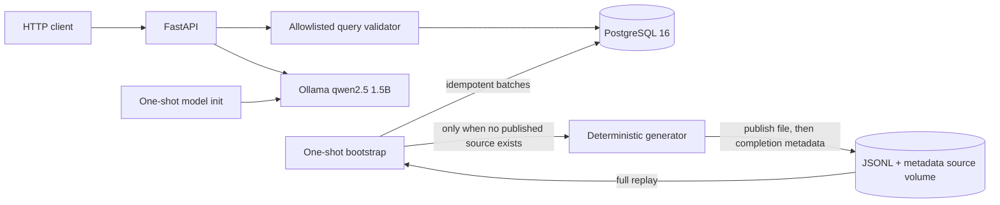

# AI-Queryable Health Data System

A small end-to-end system that generates a fixed, deterministic synthetic
heart-rate snapshot for 50 users over 21 days, atomically publishes it as
JSONL, replays that persisted source into PostgreSQL, and exposes bounded
structured and natural-language analytics.
It is a reproducible fixed synthetic demo, not a continuously updating or real-time
health service.

The generated patterns are for an engineering demonstration. They are not
clinically validated measurements and must not be used for health decisions.

## Quick start

Prerequisites:

- Docker Engine with Docker Compose v2
- Approximately 6 GB of free disk space
- Internet access on the first start for container images, Python packages,
  and the local model
- An ARM64 or AMD64 machine supported by the pinned images

Start the complete system:

```bash
docker compose up --build
```

No model command, schema command, or data-loading command is required.
Compose starts PostgreSQL and Ollama, downloads `qwen2.5:1.5b` through a
one-shot model preparation service, publishes and ingests the fixed dataset,
then starts FastAPI. The default base URL is <http://127.0.0.1:8000>.

The first start is download-heavy. Wait for `api` to report healthy:

```bash
docker compose ps --all
curl --fail http://127.0.0.1:8000/health/ready
```

Stop services while preserving data:

```bash
docker compose down
```

Remove all persisted demo data and the downloaded model:

```bash
docker compose down --volumes
```

## Architecture



Compose contains five purposeful services:

- `postgres` stores user profiles, observations, constraints, indexes, and the
  identity and outcome of the one accepted source.
- `bootstrap` atomically publishes the fixed event sequence to the source
  volume when absent, then replays it in retry-safe batches. It exits only
  after all source records have been checked against durable rows.
- `ollama` hosts the small local interpretation model.
- `model-init` downloads the pinned model when the model volume is empty and
  exits after preparation succeeds.
- `api` starts only after bootstrap and model preparation finish. It serves
  health, structured analytics, natural-language analytics, and OpenAPI.

For this bounded 21-day input, publishing a file and replaying transactional
batches keeps ingestion and recovery simple. Continuous arrivals would be a
different requirement; a broker would need a concrete benefit to justify its
operational cost.
PostgreSQL is both storage and analytical engine because this volume and the
bounded access patterns fit indexed relational aggregation.

## Data contract and synthetic patterns

The full contract and acceptance criteria are in
[`docs/specification.md`](docs/specification.md). Each v1 observation contains:

- schema version `health.heart_rate.observation.v1`;
- stable UUIDv5 event ID;
- stable user and device IDs;
- an offset-aware observation timestamp;
- metric `heart_rate`, a decimal value, and unit `bpm`;
- one of `sleep`, `rest`, `ordinary_activity`, or `workout`.

The fixed default configuration is seed `20261019`, 50 users, and
`2026-10-05T00:00:00Z` through `2026-10-26T00:00:00Z`, using a half-open
interval that includes 5–25 October. Profiles vary by time
zone, resting baseline, schedule, activity response, workout frequency, and
device-off tendency. State changes affect values and sampling cadence;
deterministic jitter avoids clockwork intervals; device-off intervals emit no
observations.

Fifty users over three weeks provide varied profiles, weekday/weekend patterns
and repeated activity cycles while keeping local generation, replay and
analytical checks manageable. Sampling is more frequent during workouts to
represent faster changes and less frequent during rest, while jitter and
device-off periods exercise irregular timing and missing-data handling.

Determinism makes the synthetic fixture reproducible for review and tests. It
does not imply that missing measurements from real people can be regenerated.
Every value is synthetic, including dates that are in the future when the
demonstration is prepared; they are not measurements already collected.

The 50 synthetic users produce 814,492 observations in the default 21-day
sample; users and observations are different counts. Representative profiles,
state-level means, a full local-day timeline, and an explicit 83.9-minute
no-reading gap are in
[`docs/synthetic-sample.md`](docs/synthetic-sample.md).

## Idempotent ingestion and recovery from persisted source

This is the first area of deliberate depth.

Bootstrap writes one event per JSONL line to a temporary file on the source
volume, flushes it, and publishes it with an atomic rename only after generation
finishes. A small sidecar records the generation configuration, line count,
unique-event count, and source digest. A compatible published source is
validated and reused without calling the event generator. An incompatible or
corrupt published source fails explicitly; a lone file from an interrupted
initial publication is not considered complete and may be regenerated.

Idempotent means that retrying the same event leaves the database with the
same observation, rather than adding another copy. A new measurement is a new
event, not a retry. This is not a general end-to-end exactly-once guarantee.
Every ingestion attempt reads that JSONL from the beginning. There is no
position checkpoint: the measured full replay is small enough that stable
event identity and idempotent inserts are simpler. Each batch commits
independently, so an interruption can leave earlier batches durable. On retry,
those rows are verified and skipped while missing rows are inserted:

- the same `event_id` and same content is accepted without another row;
- the same `event_id` with different content is an explicit error;
- a natural-key collision under another ID is an explicit error;
- malformed JSONL reports its line number instead of being ignored;
- file order is irrelevant because analytics use `observed_at`.

The demo database accepts one source configuration. Another seed, window,
population, generator version, or source content requires an isolated
database; dataset migration and coexistence are outside scope.

The recovery harness interrupts ingestion after observing committed progress,
then replays the same retained file from line one and compares the final rows
with an uninterrupted load:

```bash
./scripts/test_interrupted_ingestion.sh
```

The recorded run demonstrates recovery with earlier batches already committed.
Polling does not establish whether another transaction was open at the signal
instant. Counts, digests, and timings remain in
[`docs/october-2026-verification.md`](docs/october-2026-verification.md#replay-restart-and-interruption).

The named volume survives normal container replacement; it is not a backup,
replica, or protection against deleting or losing the volume. Real
measurements that were never persisted cannot be reconstructed by a
deterministic generator.

<a id="analytical-api"></a>

## Query semantics

This is the second area of deliberate depth: explicit semantics when sampling
is irregular and data can be absent.

Every range is half-open: `start <= observed_at < end`. Timestamps require an
offset, and ranges are limited to 31 days as a request guardrail; the 21-day
sample is never padded with invented readings. Five operations use the same
query engine:

- `user_period_average`: one time-weighted mean of all valid intervals for one
  user over the whole request;
- `user_period_resting_average`: one mean of intervals originating from that
  user's `rest` readings;
- `daily_user_average`: the same rest-only calculation grouped by the user's
  local day;
- `activity_state_comparison`: intervals grouped by the state of their
  originating reading;
- `population_daily_average`: a UTC-day mean pooled over valid user-seconds,
  not an average of per-user means.

Every `time_weighted_mean_bpm` uses a bounded constant hold. A reading
represents its value until the earliest of the next reading for the same
user/device/metric, `MAX_HOLD_SECONDS`, or the request end. The default
`HEALTH_DATA_MAX_HOLD_SECONDS=360` is an engineering assumption, not a
clinical rule. There is no linear interpolation, unlimited extrapolation, or
zero fill. Results expose
`aggregation_basis: "time_weighted_observation_hold"` and
`max_hold_seconds`.

The next reading is found before activity-state filtering, so a rest interval
stops when a later workout reading arrives. A reading before `start` can carry
in only for its remaining validity. Intervals are clipped to `[start,end)` and
split at local-day or UTC-day boundaries using real instants, including
daylight-saving transitions.

Rows expose `contributing_duration_seconds`, or
`contributing_user_seconds` and `contributing_user_count` for population days.
The separate `quality` object is returned even with `rows: []`. Individual
quality reports requested, observed and unobserved seconds, gap count and
largest gap based on any heart-rate reading before a rest filter, so excluded
workout time is not mislabeled as missing data.

Population quality computes gaps independently for every expected user in the
`users` table and reports user-seconds, expected and observed users, total gap
count, and the largest individual gap. One person's reading never covers
another person's time. These indicators describe availability under the hold
rule, not physiological coverage. Missing groups remain absent; no operation
invents a zero mean.

## Bonus 1: HTTP query endpoint

`POST /v1/query` exposes the bounded structured query engine over HTTP.
Requests select an allowlisted operation, interval, metric, conditional
`user_id`, and optional `row_limit`. Responses include the applied operation,
interval, aggregation basis, hold setting, quality metadata, and result rows.

### HTTP endpoints

The application exposes:

- `GET /` — return a 307 redirect to `/docs`;
- `GET /docs` — open the interactive Swagger UI;
- `GET /docs/oauth2-redirect` — handle the automatically generated Swagger UI
  OAuth2 callback, although this demo does not implement authentication;
- `GET /redoc` — open the alternative ReDoc documentation;
- `GET /openapi.json` — return the OpenAPI schema;
- `GET /health/live` — report application-process liveness;
- `GET /health/ready` — check database connectivity, completed ingestion,
  observations present, and model availability without running inference;
- `POST /v1/query` — execute bounded structured analytics;
- `POST /v1/query/natural-language` — translate
  [supported English questions](#bonus-2-natural-language-queries) into
  validated plans.

The generated documentation and schema routes also accept `HEAD`.

### Structured query examples

Ranges over 31 days, malformed timestamps, unknown users, unsupported
operations, metrics, or dimensions return structured HTTP 422 errors. Empty
matches return HTTP 200 with `rows: []`. `row_limit` is 1–1,000 and counts
aggregated rows, not observations; an oversized result returns HTTP 413
without partial rows. Database failures return HTTP 503 without exposing
credentials. SQL fragments are application-owned constants, request values are
bound parameters, and no route accepts arbitrary SQL.

Whole-period average of all states:

```bash
curl --fail --request POST http://127.0.0.1:8000/v1/query \
  --header 'Content-Type: application/json' \
  --data '{"operation":"user_period_average","user_id":"user-0001","start":"2026-10-05T00:00:00Z","end":"2026-10-26T00:00:00Z"}'
```

Use `user_period_resting_average` for a rest-only period mean. Both return
zero or one row with `time_weighted_mean_bpm` and
`contributing_duration_seconds`; `start` and `end` describe the requested
interval. The mean is calculated directly from held value-seconds, not from
daily means. No schema migration is needed.

Daily resting average:

```bash
curl --fail --request POST http://127.0.0.1:8000/v1/query \
  --header 'Content-Type: application/json' \
  --data '{
    "operation": "daily_user_average",
    "user_id": "user-0001",
    "metric": "heart_rate",
    "start": "2026-10-05T00:00:00Z",
    "end": "2026-10-26T00:00:00Z"
  }'
```

Activity-state comparison:

```bash
curl --fail --request POST http://127.0.0.1:8000/v1/query \
  --header 'Content-Type: application/json' \
  --data '{
    "operation": "activity_state_comparison",
    "user_id": "user-0001",
    "metric": "heart_rate",
    "start": "2026-10-05T00:00:00Z",
    "end": "2026-10-26T00:00:00Z"
  }'
```

Population daily average:

```bash
curl --fail --request POST http://127.0.0.1:8000/v1/query \
  --header 'Content-Type: application/json' \
  --data '{
    "operation": "population_daily_average",
    "metric": "heart_rate",
    "start": "2026-10-05T00:00:00Z",
    "end": "2026-10-26T00:00:00Z"
  }'
```

<a id="constrained-natural-language-layer"></a>

## Bonus 2: Natural-language queries

This bonus is a constrained interface over the same validated structured-query
path, not a third area of deliberate depth.

The small local model avoids paid API keys and keeps inference local. Its
JSON output is validated before the query engine is called.
Ollama receives a question and returns only a candidate JSON plan for the five
operations. The application then:

1. accepts either two offset-aware RFC 3339 timestamps, including fractional
   seconds, or the explicit phrase `last week`;
2. resolves `last week` at request time to the previous ISO week in application
   time zone `UTC`;
3. rejects missing user identity, unsupported metrics, unsupported
   aggregations, medical-advice requests, unsupported relative dates, and
   instruction-like input;
4. validates the model response with a strict, extra-field-forbidden schema;
5. checks exact user tokens and recognized timestamp, aggregation, grouping,
   state-filter, time-zone, and operation cues against a bounded lexical
   contract;
6. applies the same structured-query validation and limits;
7. builds parameterised SQL from application-owned statements.

Model output is never treated as SQL and SQL fields are rejected. Missing or
ambiguous scope is rejected instead of inferred. Model unavailability returns
HTTP 503. Every successful response includes `interpreted_query` and
`temporal_interpretation`, including the resolved range, reference time, and
time zone, beside the result. First-person questions such as “my heart rate”
without an explicit user ID are rejected because authentication is not
implemented and there is no authenticated identity to resolve.
This validator deliberately recognizes a constrained vocabulary; it rejects
known incompatibilities and does not claim general understanding of arbitrary
natural language.

```bash
curl --fail --request POST \
  http://127.0.0.1:8000/v1/query/natural-language \
  --header 'Content-Type: application/json' \
  --data '{
    "question": "What was user-0001'\''s average resting heart rate each day from 2026-10-05T00:00:00Z to 2026-10-26T00:00:00Z?"
  }'
```

Only `last week` is supported as relative shorthand; expressions such as
`today`, `last month`, or `past 30 days` are rejected, including when mixed
with explicit timestamps. The main demo uses explicit dates because it is a
fixed October 2026 snapshot. A `last week` request is relative to the real
request time and can return data only when that previous ISO week overlaps the
snapshot; otherwise it returns `rows: []`. The response exposes the resolved
bounds, request reference time, and time zone; it never shifts `last week`
back to the data window merely to produce rows.

“What was user-0001's average heart rate last week?” selects
`user_period_average`; adding “resting” selects
`user_period_resting_average`, and adding “each day” to the resting question
selects `daily_user_average`. Unsupported hourly/device grouping, maximum, and
median remain rejected.

The model client has a 30-second timeout. The first inference after startup can
exceed it and return HTTP 503; a later request with the model loaded can
succeed. This is a startup limitation, not a result attributed exclusively to
one environment. `/health/ready` checks model availability by listing the
model; it does not run inference. Once the API is running, `/v1/query` does not
call the model.

<a id="tests"></a>
<a id="october-2026-window-verification"></a>
<a id="current-time-weighted-verification"></a>

## Tests and verification

The tests use Python 3.11 or newer and a disposable PostgreSQL instance:

```bash
docker run --name health-data-test-postgres \
  --detach \
  --publish 55432:5432 \
  --env POSTGRES_HOST_AUTH_METHOD=trust \
  --env POSTGRES_DB=health_data \
  postgres:16.6-alpine

python3 -m venv .venv
.venv/bin/python -m pip install -e .
.venv/bin/python -m unittest discover -s tests -v

docker rm --force health-data-test-postgres
```

Coverage includes JSONL round-tripping and atomic publication, source reuse
and incompatibility, duplicate/conflicting/out-of-order ingestion,
post-commit retry, all five query operations, hand-calculated time-weighted
answers, gap reporting, time-zone boundaries, and daylight-saving changes.

The empty- and preserved-state Compose flow is reproducible with:

```bash
./scripts/clean_start_e2e.sh
```

This destructive script removes the selected Compose project's test volumes,
starts the complete system, checks structured and natural-language endpoints,
measures replay, then restarts with volumes preserved and confirms the row
count. Use an isolated project; it must not target data that needs to be kept.

Run the natural-language evaluation against the live Compose API:

```bash
python3 scripts/evaluate_natural_language.py
```

A later disposable PostgreSQL 16.6 run passed 80 tests. The detailed
time-weighted record covers the underlying 79-test revision and an isolated
Compose run over the 814,492-event source. Its natural-language evaluation
passed 30 live requests: eight reached the real model and matched structured
results, while 22 were rejected before model use. Two additional
model-unavailable and invalid-output cases were simulated fault tests, not live
model calls. See
[`docs/time-weighted-verification.md`](docs/time-weighted-verification.md).

The earlier October-window run predates time weighting and remains historical
evidence; its measurements were not repeated for this README revision. See
[`docs/october-2026-verification.md`](docs/october-2026-verification.md).
The [interview defense](docs/interview-defense.md) and
[code explanation](docs/code-explanation.md) describe the current behavior.

## Decisions and tradeoffs

- A fixed window makes restart behavior reproducible; it does not look
  perpetually current.
- Full JSONL replay instead of a broker or positional checkpoint keeps recovery
  inspectable and is acceptable at this demo's measured scale; materially
  larger sources require new measurements before keeping this choice.
- One constrained heart-rate table provides stronger checks and clearer
  indexes than a generic entity-attribute-value schema; adding another metric
  requires a deliberate migration.
- One indexed PostgreSQL table fits this sample and its query patterns.
  Partitioning would add maintenance without a demonstrated benefit here;
  larger histories need measurements of query pruning and retention needs.
- A bounded constant hold makes irregular timing and missing intervals explicit
  without inventing interpolation. The 360-second default limits stale carry
  forward; changing it changes both means and reported availability and
  therefore requires deliberate configuration and validation.
- UUIDv5 and a natural unique key spend extra index space to defend against
  both replay and identity-algorithm defects.
- Relative dates are intentionally narrow: `last week` means the previous ISO
  week relative to the real request time in UTC. Other shorthand is rejected
  rather than guessed, and an out-of-snapshot range returns an empty result.
- The 1.5B local model keeps inference local and avoids paid API keys.
  Application validation checks its candidate plan before database execution.

## AI usage

### What did I delegate to AI?

I used AI extensively to write and review code, tests, Docker Compose
configuration and documentation, and to explore architectural alternatives. I
also used it to look for bugs and help validate ingestion, queries and
integration with the local model.

### Where did I intervene or make corrections?

I questioned architectural decisions, the definitions of activity states
(such as sleep versus rest), and how averages were calculated. I asked for a
time-weighted average instead of a simple average of readings because sampling
frequency varies between states.

I asked for generated data to be saved to a file before loading it into the
database. If ingestion fails, we can then read the same data again without
duplicating records already inserted, rather than relying on generating it
again.

Implementation of these revisions was still delegated to AI. My role was to
define the intended behavior and ask for evidence before accepting the result.

### What would I not trust AI with, and why?

I would not trust AI to make the final decisions about metric semantics,
assess clinical realism, define security boundaries, or decide whether the
system meets the requirements. A query can be syntactically correct and still
calculate the wrong thing; plausible data is not clinically validated data;
and AI-generated tests can repeat the same mistaken assumptions as the code.
Natural-language interpretation must be treated as untrusted input, with
validation and restrictions enforced by the application. Documented
guarantees must be based on observed execution and verifiable results, not on
how confident the AI sounds.

## If you had two more weeks, what would you build next?

I would first add authentication, per-person authorization, TLS, rate limiting and access auditing before exposing the service publicly. I would improve model reliability with warm-up, diagnostics and separate checks for structured-query readiness and inference readiness. Next, I would test larger datasets and concurrent requests, adding a bounded connection pool only if measurements justify it. I would also automate a clean-start deployment check and rehearse backup and restore. Partitioning, archival formats or streaming would depend on demonstrated scale, retention needs or a change to continuous data arrival.
