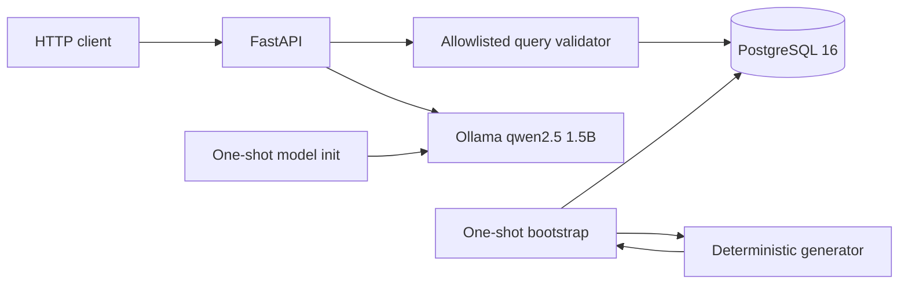

# AI-Queryable Health Data System

A small end-to-end system that generates deterministic synthetic heart-rate
observations for 50 users over seven days, ingests them directly into
PostgreSQL, and exposes bounded structured and natural-language analytics.

The generated patterns are for an engineering demonstration. They are not
clinically validated measurements and must not be used for health decisions.

## Quick start

Prerequisites:

- Docker Engine with Docker Compose v2
- Approximately 6 GB of free disk space
- Internet access on the first start for container images, Python packages,
  and the local model
- An ARM64 or AMD64 machine supported by the pinned images

Start the complete system:

```bash
docker compose up --build
```

No model command, schema command, or data-loading command is required.
Compose starts PostgreSQL and Ollama, downloads `qwen2.5:1.5b` through a
one-shot model preparation service, generates and ingests the fixed dataset,
then starts FastAPI at <http://127.0.0.1:8000>. OpenAPI documentation is at
<http://127.0.0.1:8000/docs>.

The first start is download-heavy. Wait for `api` to report healthy:

```bash
docker compose ps --all
curl --fail http://127.0.0.1:8000/health/ready
```

Stop services while preserving data:

```bash
docker compose down
```

Remove all persisted demo data and the downloaded model:

```bash
docker compose down --volumes
```

## Architecture



Compose contains five purposeful services:

- `postgres` stores user profiles, observations, constraints, indexes, and
  durable ingestion progress.
- `bootstrap` generates the fixed event sequence and writes retry-safe batches.
  It exits only after all batches are durable.
- `ollama` hosts the small local interpretation model.
- `model-init` downloads the pinned model when the model volume is empty and
  exits after preparation succeeds.
- `api` starts only after bootstrap and model preparation finish. It serves
  health, structured analytics, natural-language analytics, and OpenAPI.

There is no broker. For a deterministic seven-day batch, a broker adds
deployment and recovery paths without improving the demonstrated guarantees.
PostgreSQL is both storage and analytical engine because this volume and the
three access patterns fit indexed relational aggregation.

## Data contract and synthetic patterns

The full contract and acceptance criteria are in
[`docs/specification.md`](docs/specification.md). Each v1 observation contains:

- schema version `health.heart_rate.observation.v1`;
- stable UUIDv5 event ID;
- stable user and device IDs;
- an offset-aware observation timestamp;
- metric `heart_rate`, a decimal value, and unit `bpm`;
- one of `sleep`, `rest`, `ordinary_activity`, or `workout`.

The fixed default configuration is seed `20261019`, 50 users, and
`2026-01-05T00:00:00Z` through `2026-01-12T00:00:00Z`. Profiles vary by time
zone, resting baseline, schedule, activity response, workout frequency, and
device-off tendency. State changes affect values and sampling cadence;
deterministic jitter avoids clockwork intervals; device-off intervals emit no
observations.

The observed sample contains 271,620 events. Representative profiles,
state-level means, a full local-day timeline, and an explicit 74.7-minute
no-reading gap are in
[`docs/synthetic-sample.md`](docs/synthetic-sample.md).

## Idempotent ingestion and recovery

This is the first area of deliberate depth.

The dataset run key hashes schema version, generator version, seed, fixed
window, and population. PostgreSQL separately records the batch size, expected
count, total batches, next batch, inserted count, and status. A restart with a
different batch size is rejected because existing checkpoints depend on that
size. Event inserts and checkpoint advance commit in the same transaction:

- termination before commit preserves neither the batch nor its checkpoint;
- termination after commit preserves both;
- restart regenerates the same ordered sequence and skips committed batches;
- a completed replay inserts nothing;
- primary-key and natural-key constraints independently prevent duplicates.

The actual recovery harness sends `SIGKILL` after a known commit:

```bash
./scripts/test_interrupted_ingestion.sh
```

The observed run stopped at batch 5 with exactly 5,000 durable events. Restart
inserted the remaining 266,620. The recovered and uninterrupted databases both
contained 271,620 events with digest
`2791d4a9a5996490ff6191256d36ca5a`. Full evidence is in
[`docs/interruption-verification.md`](docs/interruption-verification.md).

## Analytical API

Every range is half-open: `start <= observed_at < end`. Timestamps require an
offset, ranges are limited to 31 days, and responses are limited to 1,000 rows.
An empty match returns HTTP 200 with an empty `rows` array. Oversized results
return HTTP 413 rather than silent truncation. Unsupported operations, metrics,
dimensions, users, and malformed timestamps return structured errors.

Only three operations exist:

- `daily_user_average`: one user's resting average grouped by local day;
- `activity_state_comparison`: one user's average and count by activity state;
- `population_daily_average`: average, observation count, and user count by
  UTC day.

SQL operation and grouping fragments are application-owned constants. Every
request value is a bound parameter. No route accepts arbitrary SQL.

Daily resting average:

```bash
curl --fail --request POST http://127.0.0.1:8000/v1/query \
  --header 'Content-Type: application/json' \
  --data '{
    "operation": "daily_user_average",
    "user_id": "user-0001",
    "metric": "heart_rate",
    "start": "2026-01-05T00:00:00Z",
    "end": "2026-01-12T00:00:00Z"
  }'
```

Activity-state comparison:

```bash
curl --fail --request POST http://127.0.0.1:8000/v1/query \
  --header 'Content-Type: application/json' \
  --data '{
    "operation": "activity_state_comparison",
    "user_id": "user-0001",
    "metric": "heart_rate",
    "start": "2026-01-05T00:00:00Z",
    "end": "2026-01-12T00:00:00Z"
  }'
```

Population daily average:

```bash
curl --fail --request POST http://127.0.0.1:8000/v1/query \
  --header 'Content-Type: application/json' \
  --data '{
    "operation": "population_daily_average",
    "metric": "heart_rate",
    "start": "2026-01-05T00:00:00Z",
    "end": "2026-01-12T00:00:00Z"
  }'
```

## Constrained natural-language layer

This is the second area of deliberate depth.

Ollama receives a question and returns only a candidate JSON plan for the three
operations. The application then:

1. accepts either two offset-aware timestamps or the explicit phrase `last
   week`;
2. resolves `last week` to the previous ISO week using reference
   `2026-01-12T00:00:00Z` and application time zone `UTC`;
3. rejects missing user identity, unsupported metrics, and instruction-like
   input before model use;
4. validates the model response with a strict, extra-field-forbidden schema;
5. proves that user and resolved timestamps match application-owned context;
6. applies the same structured-query validation and limits;
7. builds parameterised SQL from application-owned statements.

Model output is never treated as SQL and SQL fields are rejected. Missing or
ambiguous scope is rejected instead of inferred. Model unavailability returns
HTTP 503. Every successful response includes `interpreted_query` and
`temporal_interpretation`, including the resolved range, reference time, and
time zone, beside the result. First-person questions such as “my heart rate”
remain rejected because authentication does not provide a user identity.

```bash
curl --fail --request POST \
  http://127.0.0.1:8000/v1/query/natural-language \
  --header 'Content-Type: application/json' \
  --data '{
    "question": "What was user-0001'\''s average resting heart rate last week?"
  }'
```

Run the eight-case evaluation manifest:

```bash
python3 scripts/evaluate_natural_language.py
```

Six live cases cover the three supported shapes, the relative-date question,
an ambiguous question, and an unsupported metric. The same explicit manifest
includes invalid model output and model unavailability; those two
fault-injection cases run in isolated tests. Further isolated checks cover
malformed JSON and invented users and dates.

## Tests

The tests use Python 3.11 or newer and a disposable PostgreSQL instance:

```bash
docker run --name health-data-test-postgres \
  --detach \
  --publish 55432:5432 \
  --env POSTGRES_HOST_AUTH_METHOD=trust \
  --env POSTGRES_DB=health_data \
  postgres:16.6-alpine

python3 -m venv .venv
.venv/bin/python -m pip install -e .
.venv/bin/python -m unittest discover -s tests -v

docker rm --force health-data-test-postgres
```

The updated run passed 42 tests in 15.673 seconds. Hand-calculated fixtures check
all three operations. The final empty-state Compose flow is reproducible with:

```bash
./scripts/clean_start_e2e.sh
```

That destructive test removes this Compose project's named volumes, starts the
complete system, checks both endpoints and a rejection, then proves bootstrap
replay leaves the row count unchanged.

## Measured verification

The updated empty-persisted-state run completed in 99 seconds on ARM64 with
cached image layers but empty PostgreSQL and Ollama volumes. It downloaded the
model, generated and stored 271,620 observations, returned checked structured
and natural-language responses, rejected an ambiguous question with HTTP 422,
and replayed with zero inserts. The updated live model evaluation passed 6/6.

The exact responses, environment, corrected failures, test evidence, and
measurement boundary are in
[`docs/verification.md`](docs/verification.md). In particular, 99 seconds is
not claimed as a no-cache fresh-VM time.

## Decisions and tradeoffs

- A fixed window makes restart behavior reproducible; it does not look
  perpetually current.
- One constrained heart-rate table provides stronger checks and clearer
  indexes than a generic entity-attribute-value schema; adding another metric
  requires a deliberate migration.
- PostgreSQL is sufficient at demo volume; high-rate longitudinal production
  data would require retention, partitioning, compression, and load evidence.
- UUIDv5 and a natural unique key spend extra index space to defend against
  both replay and identity-algorithm defects.
- Relative dates are intentionally narrow: `last week` means the previous ISO
  week under a configured reference timestamp and time zone. Other shorthand
  is rejected rather than guessed.
- The 1.5B local model keeps data local and avoids paid credentials, but its
  image/model download dominates first startup and its interpretation quality
  is bounded by the explicit validator.

## Development process and review boundaries

Initial scaffolding, implementation drafts, test cases, Compose wiring, and
documentation structure were delegated. Runtime and test claims in this README
are limited to commands recorded in `docs/verification.md`. Corrections
included a Python-version dependency mismatch, a packaged schema path, Compose
image ownership, API dependency resolution, and two rejected local-model
plans.

Review checkpoints covered scope, synthetic-pattern plausibility, query and
error boundaries, recovery evidence, and final claims. This repository records
runtime evidence, not reviewer identities or approvals. Clinical validity,
production security, privacy policy, and operational readiness still require
domain-owner review and environment-specific evidence.

## Limitations

- A no-cache new VM and AMD64 were not available for execution; ARM64 and
  empty named volumes were tested.
- There is no authentication, authorization, TLS termination, rate limiting,
  per-user tenancy boundary, or audit log.
- There is no connection pool, horizontal API deployment, partition lifecycle,
  backup/restore automation, or production monitoring.
- The synthetic generator models recognizable schedules and gaps, not
  physiology.
- The API supports three intentionally narrow operations and one metric.
- Image tags and Python direct dependencies are pinned, but image digests and
  the complete transitive Python dependency graph are not locked.
- The live model can still emit an invalid plan; that path is rejected and
  returned as an error.

## If you had two more weeks, what would you build next?

I would add authenticated tenant-scoped access, PostgreSQL range partitioning and retention, a connection pool, OpenTelemetry traces and query-cost metrics, property-based generator and recovery tests, an AMD64/no-cache CI acceptance run, signed image digests and a complete dependency lock, model-quality regression reporting over a larger adversarial corpus, and a reviewed privacy/threat model before expanding to another health metric.
